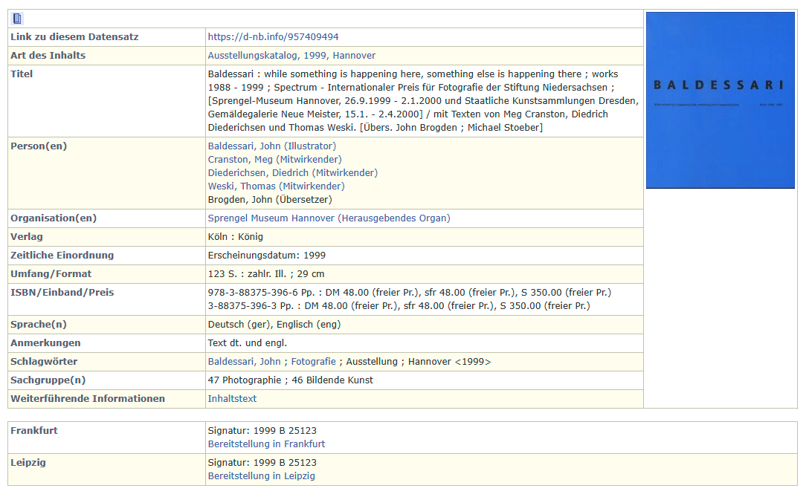
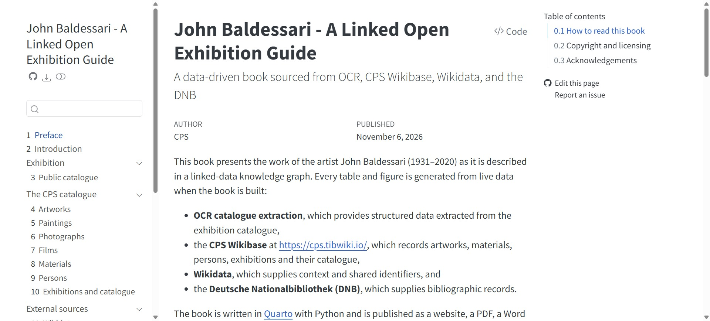
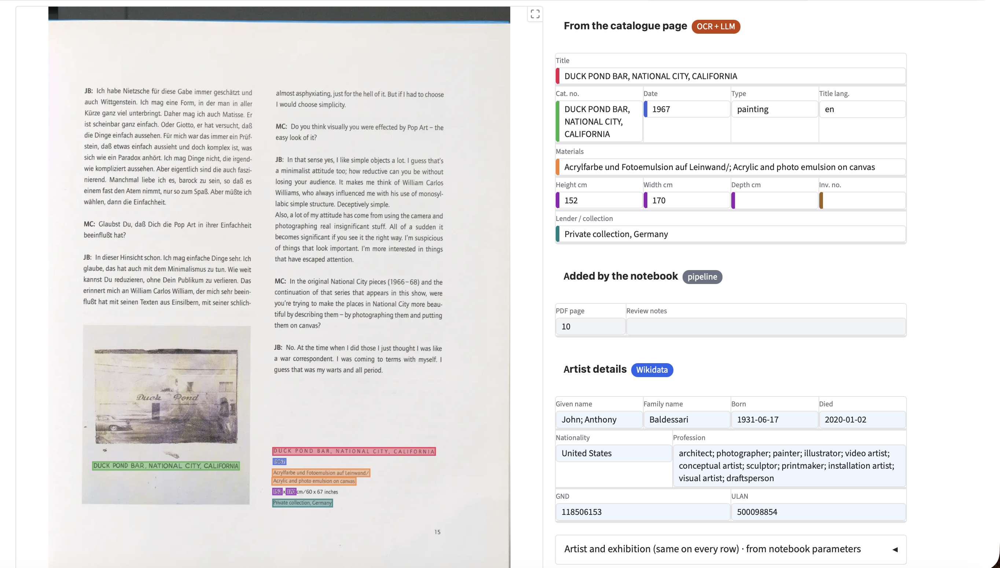
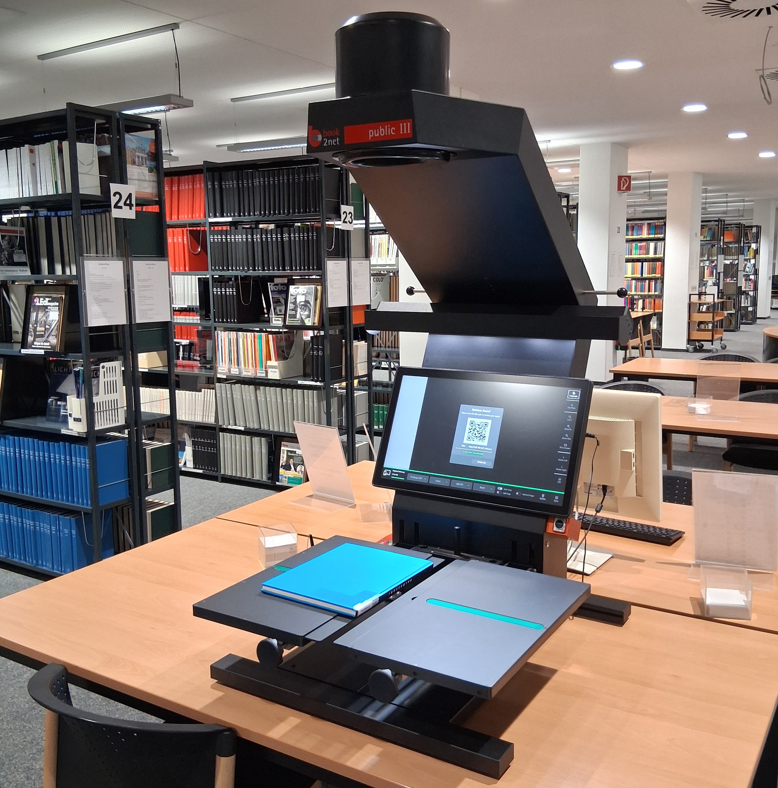

## A Homage to Winckelmann (1717-68) {.smaller}

::: {style="text-align: center;"}
 
:::

::: aside
Image credit: Anton Raphael Mengs (after 1755), [Wikimedia Commons](https://commons.wikimedia.org/wiki/File:Johann_Joachim_Winckelmann_(Raphael_Mengs_after_1755).jpg) | Wikidata: [Q19905230](https://www.wikidata.org/wiki/Q19905230)
:::

---

## A Public Record of Art in Exhibitions {.smaller}

Deposit Linked Open Data in Wikidata  

```{mermaid}
%%| fig-align: center
%%{init: {'flowchart': {'htmlLabels': false, 'padding': 140, 'nodeSpacing': 100, 'curve': 'linear'}, 'themeVariables': {'fontFamily': 'Futura, "Century Gothic", "Trebuchet MS", sans-serif'}}}%%
flowchart LR
  A(("&ensp;Work of Art&ensp;")):::red --> B(("&emsp;Part of&emsp;")):::yellow --> C(("&emsp;Exhibition &emsp;")):::blue
  classDef red fill:#D62718,stroke:#000,stroke-width:8px,color:#fff,font-size:30px,font-weight:bold
  classDef yellow fill:#F2C500,stroke:#000,stroke-width:8px,color:#000,font-size:30px,font-weight:bold
  classDef blue fill:#1D4E9E,stroke:#000,stroke-width:8px,color:#fff,font-size:30px,font-weight:bold
  linkStyle default stroke:#000,stroke-width:8px
```

::: {style="text-align: center; font-size: 0.8em;"}
**Legend (CIDOC CRM):** E22 Human-Made Object | P19i forms part of | E7 Activity 
:::

---

## A Typical Public Exhibition Record {.smaller} 

::: {style="text-align: center;"}

:::

---

## Link Open Exhibition Demo{.smaller}

::::: columns
::: {.column width="50%"}
#### John Baldessari: Exhibition Catalogue Sprengel Museum Hannover, 26.9.1999 - 2.1.2000

:::

::: {.column width="50%"}
 - Artworks and exhibition are connected
 - Mapped to CIDOC/AAT/Iconclass
 - Loaded on to Wikibase/Wikidata
 - Make publications or use on websites    
 - Source can be: Database; OCR; Manual entry

::: {style="text-align: center;"}
<a href="https://nfdi4culture.github.io/Baldessari/"></a>
:::
:::

:::::

::: aside
Demo - [https://nfdi4culture.github.io/Baldessari/](https://nfdi4culture.github.io/Baldessari/). Exhibition - Baldessari: while something is happening here, something else is happening there : works 1988–1999. Sprengel Museum Hannover and the Staatliche Kunstsammlungen Dresden, 1999-2000
:::

---

## OCR and AI LLM {.smaller}

::::: columns
::: {.column width="60%"}
#### Tesseract OCR (can be Open-Weight LLM Model), guided by schemas, extract all 73 artworks from scan. Claude built Gravio UI built for manual review.

:::

::: {.column width="40%"}
- Scan the printed catalogue
- OCR extracts the text
- AI LLM can structures the entries
- Check and correct manually
- Data piped into Wikibase (Wikidata)
- Only use Metadata and TDM permitted for research purposes 
:::
:::::

---

## Dear Curators - Thanks for All the Art! {.smaller}

::::: columns
#### Book Scanner at Hochschule Hannover Library
::: {.column width="60%"}

:::

::: {.column width="40%"} 
Art and design school libraries are one of the few places that have the current public records of exhibitions as print exhibition catalogues. 

This resource should be OCR scanned and made public for all. With AI LLM Open-Weight workflows and Open Science infrastructures this is now possible. 
:::
:::::

---

## Info and credits {.smaller}

Catalogue of works by the artists John Baldessari shown in an art exhibition at the Sprengel Museum Hannover 26.9.1999 - 2.1.2000.  

OCR workflow: Chloë Farr, ORCID iD: 0009-0007-1146-6745

Concept and execution: Simon Worthington, ORCID iD: 0000-0002-8579-9717

Thank you to the students of the Bachelor of Arts Information Management at Hochschule Hannover [BIM-126-02 Data Science](https://www.hs-hannover.de/studium/studienangebot/bachelor/information-management/) (SoSe 2026)

Demo and Wikibase: [nfdi4culture.github.io/Baldessari/](https://nfdi4culture.github.io/Baldessari/) and [cps.tibwiki.io](https://cps.tibwiki.io). 

::: {style="text-align: center;"}
<a href="https://nfdi4culture.github.io/Baldessari/"></a>
:::
